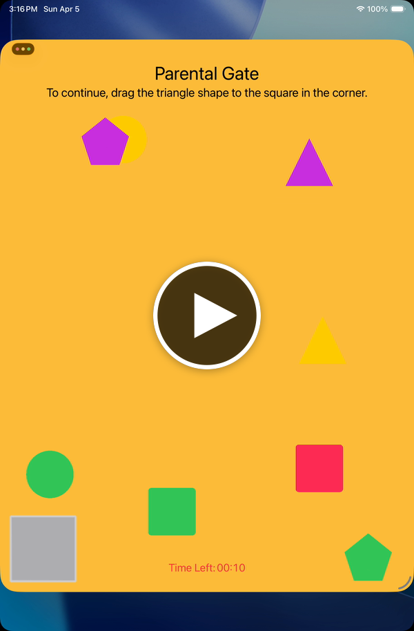

# ShapelyParentalGate

A lightweight SwiftUI parental gate for iOS. Before giving a child access to settings, in-app purchases, external links, or any other restricted action, present a shape‑matching challenge that a young child is unlikely to complete but an adult can finish in seconds.

The gate shows a bouncing cloud of shapes (circles, squares, triangles, pentagons) driven by SpriteKit physics. The user has to drag a randomly chosen target shape into a box within a configurable time limit and a configurable number of allowed misses.

## Demo

<p align="center">
  <a href="https://www.hotngui.com/media/ShapelyParentalGate-demo.mp4">
    
  </a>
</p>

## Requirements

- iOS 26+
- Swift 6.2+
- Xcode 26+

## Installation

### Swift Package Manager

In Xcode, choose **File → Add Package Dependencies…** and enter:

```
https://github.com/hotngui/ShapelyParentalGate.git
```

Or add it to your own `Package.swift`:

```swift
dependencies: [
    .package(url: "https://github.com/hotngui/ShapelyParentalGate.git", from: "3.0.0")
],
targets: [
    .target(
        name: "YourApp",
        dependencies: ["ShapelyParentalGate"]
    )
]
```

## Usage

### View modifier (recommended)

The easiest way to integrate is the `.shapelyParentalGate` view modifier. It presents the gate as a full‑screen cover and calls back with the result:

```swift
import SwiftUI
import ShapelyParentalGate

struct SettingsButton: View {
    @State private var showGate = false

    var body: some View {
        Button("Parent Settings") {
            showGate = true
        }
        .shapelyParentalGate(isPresented: $showGate) { success in
            if success {
                // proceed to the restricted action
            }
        }
    }
}
```

### Configuring the gate

Pass a `ShapelyParentalGateStaticConfiguration` to tune behavior:

```swift
let configuration = ShapelyParentalGateStaticConfiguration(
    localizedStringsFilePath: Bundle.main.path(forResource: "ParentalGateStrings", ofType: "plist"),
    maximumFailedAttempts: 3,
    supportsTimeOut: true,
    maximumTimeAllowed: 20,
    numberOfEachShape: 2
)

.shapelyParentalGate(isPresented: $showGate, configuration: configuration) { success in
    // ...
}
```

| Parameter | Default | Description |
|---|---|---|
| `localizedStringsFilePath` | `nil` | Optional path to an app‑provided plist that overrides any/all of the gate's strings. See [Localization](#localization). |
| `maximumFailedAttempts` | `2` | Number of wrong‑shape drops allowed before the gate fails. |
| `supportsTimeOut` | `true` | Whether the countdown is enforced. |
| `maximumTimeAllowed` | `10` | Seconds the user has to drop the correct shape. |
| `numberOfEachShape` | `2` | How many of each shape kind are created in the scene. |
| `backgroundColor` | orange (`#FFBD3A`) | Color behind the bouncing shapes. |
| `titleColor` | `.primary` | Color of the title text. |
| `descriptionColor` | `.primary` | Color of the text telling the user which shape to drag. |
| `countdownColor` | `.red` | Color of the countdown label and its time value. |
| `targetFillColor` | `systemGray2` | Fill color of the target box in the bottom‑left corner. |
| `targetOutlineColor` | `systemGray4` | Color of the target box's outline and glow. |

### Matching your app's colors

All six color parameters take a SwiftUI `Color` and are optional. Any you leave out keep the gate's original look, so you can change just the background or restyle everything:

```swift
let configuration = ShapelyParentalGateStaticConfiguration(
    backgroundColor: Color(white: 0.15),
    titleColor: .white,
    descriptionColor: Color(white: 0.85),
    countdownColor: .orange,
    targetFillColor: Color(white: 0.3),
    targetOutlineColor: .orange
)
```

Colors from your asset catalog bring their light and dark variants with them. The gate doesn't adjust your colors, so check that the title, description, and countdown have enough contrast against your background (WCAG AA asks for at least 4.5:1 for normal text). The shapes keep their own random colors.

### Using the view directly

If you'd rather embed the gate yourself instead of using the modifier, instantiate `ShapelyParentalGateView` directly:

```swift
ShapelyParentalGateView(configuration: configuration) { success in
    // ...
}
```

## Localization

The package ships with locale‑aware default strings and an override mechanism so your app can supply its own wording or add languages the package doesn't cover.

### Built‑in languages

Out of the box, the package's default strings resolve for:

- English (`en`) — fallback
- Spanish (`es`)

Lookups use `Bundle.module` with `defaultLocalization: "en"`, so the correct language is picked automatically based on the device's current locale. For any unsupported language the package falls back to English.

### Adding your own languages / overriding wording

If your app needs to support a language the package doesn't include — or you want to tweak any of the built‑in strings — supply a plist and pass its path to the configuration.

**1. Create `ParentalGateStrings.plist` in your app target.** The schema is a two‑level dictionary: `Category → Key → { value, comment }`.

```xml
<?xml version="1.0" encoding="UTF-8"?>
<!DOCTYPE plist PUBLIC "-//Apple//DTD PLIST 1.0//EN" "http://www.apple.com/DTDs/PropertyList-1.0.dtd">
<plist version="1.0">
<dict>
    <key>Primary</key>
    <dict>
        <key>Title</key>
        <dict>
            <key>value</key>
            <string>Parental Gate</string>
            <key>comment</key>
            <string></string>
        </dict>
        <!-- ...more Primary keys... -->
    </dict>
    <!-- ...TooManyAttempts, TimeExpired... -->
</dict>
</plist>
```

**2. Localize the plist in Xcode.** Select the file in the project navigator, open the File Inspector, click **Localize…**, and tick each language you want to support. Xcode creates `<lang>.lproj` directories and copies the plist into each one. Translate each copy.

**3. Resolve the path via `Bundle.main` and pass it to the configuration.** `Bundle.main.path(forResource:ofType:)` automatically returns the locale‑appropriate copy at runtime:

```swift
let filePath = Bundle.main.path(forResource: "ParentalGateStrings", ofType: "plist")

let configuration = ShapelyParentalGateStaticConfiguration(
    localizedStringsFilePath: filePath
)
```

Your override plist only needs to include the keys you want to change — missing keys fall back to the package's locale‑aware defaults.

### String keys

The full set of keys the gate looks up:

| Category | Key | Where it appears |
|---|---|---|
| `Primary` | `Title` | Header at the top of the gate |
| `Primary` | `Countdown` | Label preceding the countdown timer |
| `Primary` | `DescriptionCircle` | Instruction when the target shape is a circle |
| `Primary` | `DescriptionSquare` | Instruction when the target shape is a square |
| `Primary` | `DescriptionTriangle` | Instruction when the target shape is a triangle |
| `Primary` | `DescriptionPentagon` | Instruction when the target shape is a pentagon |
| `TooManyAttempts` | `Title` | Alert title after too many wrong drops |
| `TooManyAttempts` | `Description` | Alert message after too many wrong drops |
| `TooManyAttempts` | `OK` | Alert dismiss button title |
| `TimeExpired` | `Title` | Alert title when the countdown hits zero |
| `TimeExpired` | `Description` | Alert message when the countdown hits zero |
| `TimeExpired` | `OK` | Alert dismiss button title |

### Lookup order

When the gate resolves a string it checks, in order:

1. The app's override plist (if `localizedStringsFilePath` was provided)
2. The package's default plist for the current locale
3. The package's English defaults

## Example

A complete working example lives in `Example/TestParentalGate`. It demonstrates the view modifier, a custom configuration, a second gate restyled with custom colors ("Show Customized Gate"), and full English / Spanish / French localization for both the example app's own UI and the parental gate's strings. Open `Example/TestParentalGate.xcodeproj`, pick a simulator, and run.

To try a different language, change the simulator's language under **Settings → General → Language & Region → iPhone Language**.

## License

See [LICENSE](LICENSE).
